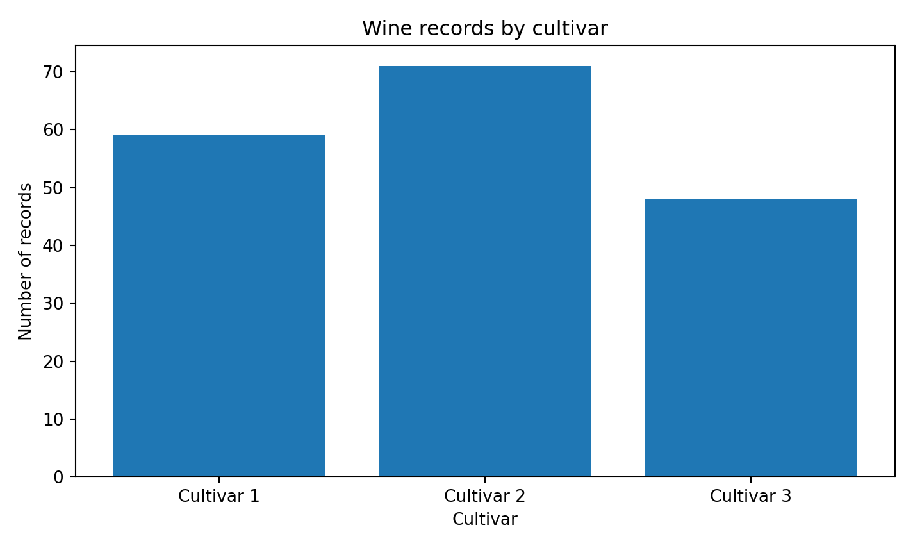
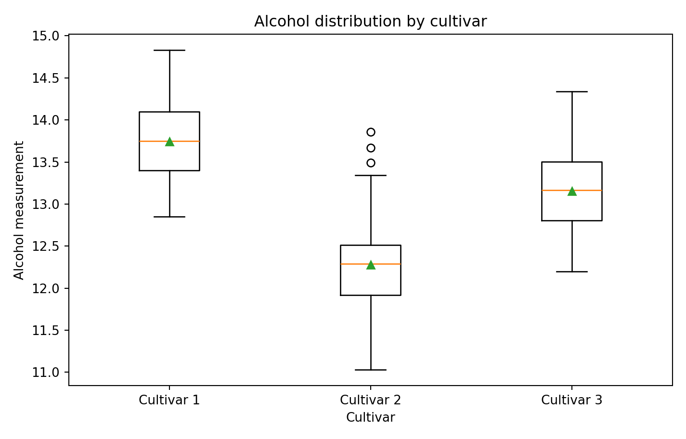
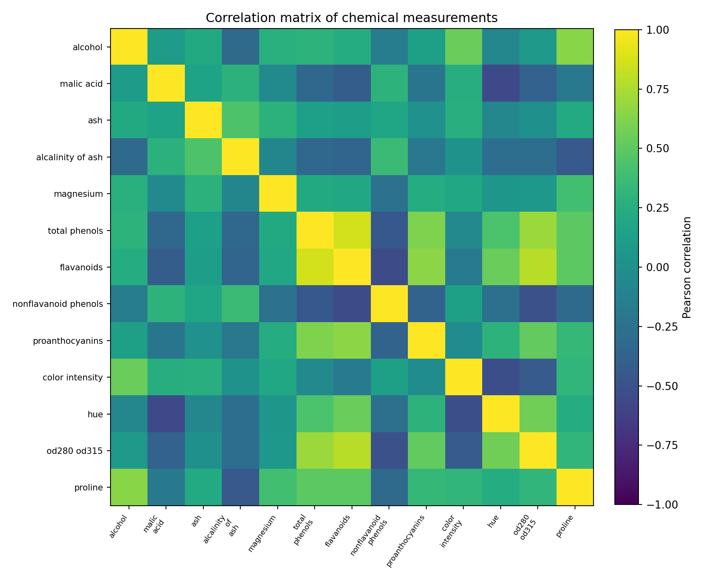
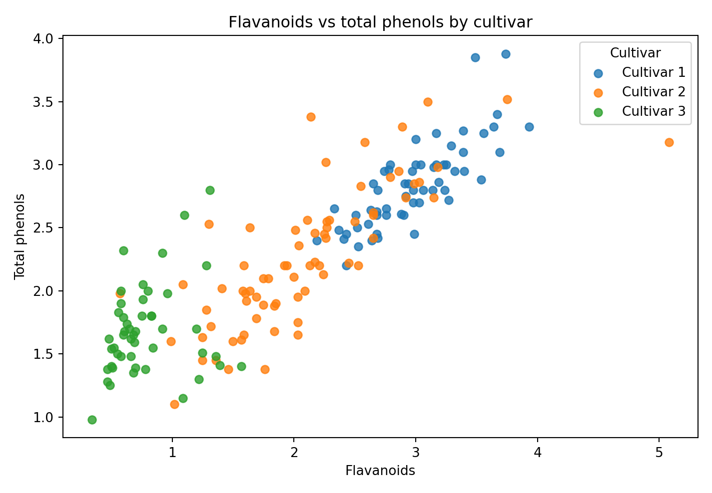
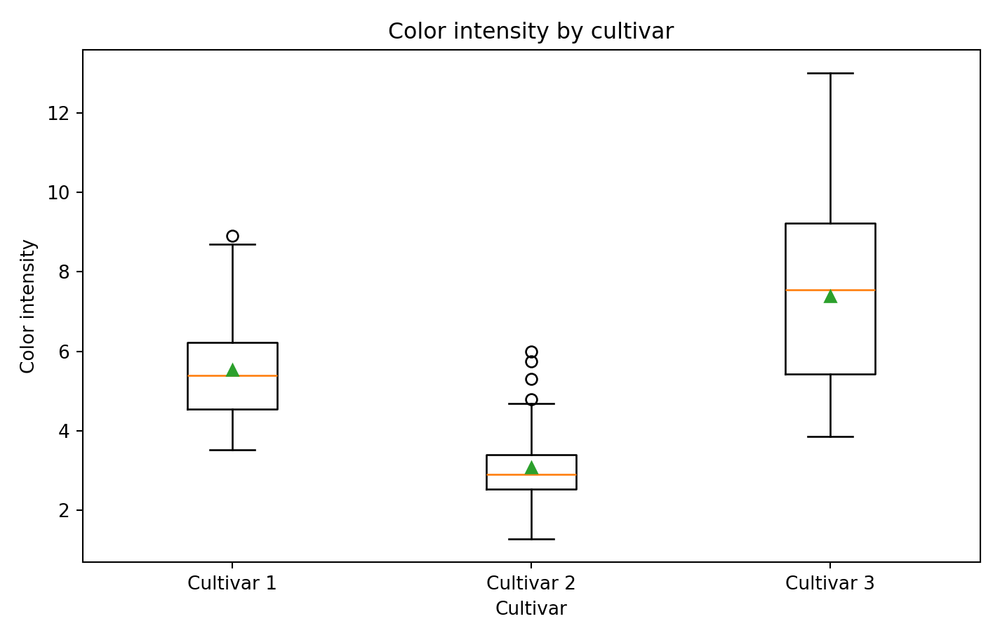

# Wine Cultivar Classification with R

**Virtual Data Science with R Apprentice Internship | Five-week integrated project**

A reproducible R workflow that explores, prepares, visualizes, and classifies the UCI Wine Recognition dataset. The project follows the data-science lifecycle across project planning, exploratory data analysis, data wrangling, predictive modelling, and final reporting.

> **Important distinction:** This is the UCI **Wine Recognition** dataset (cultivar classification), not the separate Wine Quality dataset. The target is one of three wine cultivars; the project does not predict taste, quality ratings, price, or health effects.

## Project at a glance

| Item | Description |
|---|---|
| Objective | Classify a wine sample into one of three cultivar groups from chemical measurements |
| Dataset | UCI Wine Recognition (UCI dataset ID 109) |
| Observations | 178 |
| Predictors | 13 numeric chemical measurements |
| Target | Three cultivar classes (original labels 1, 2, and 3) |
| Task type | Supervised, multiclass classification |
| Main language | R |
| R packages | `MASS`, `nnet`; the cleaning and EDA scripts use base R |
| Models | Linear Discriminant Analysis (LDA) and Multinomial Logistic Regression |

The dataset records chemical analyses of wines grown in the same region in Italy but derived from three different cultivars. The class counts in the packaged data are 59, 71, and 48. The UCI record describes 178 instances and 13 features, with no missing values reported. [UCI dataset page](https://archive.ics.uci.edu/dataset/109/wine) · [Dataset DOI](https://doi.org/10.24432/C5PC7J)

## Problem statement

Can the cultivar associated with a wine sample be predicted from its 13 measured chemical constituents? The project uses descriptive analysis and two supervised classification approaches to explore this question, with a held-out test set for model evaluation.

## Dataset features

The predictors are:

- Alcohol
- Malic acid
- Ash
- Alcalinity of ash
- Magnesium
- Total phenols
- Flavanoids
- Nonflavanoid phenols
- Proanthocyanins
- Color intensity
- Hue
- OD280/OD315 of diluted wines
- Proline

The supplied CSV is `data/raw/wine_recognition_raw.csv`. It is packaged from the public Wine Recognition copy distributed with scikit-learn, with the original UCI class codes represented as 1, 2, and 3. The cleaned project data uses readable, standardized column names and restores these labels as `Cultivar 1`, `Cultivar 2`, and `Cultivar 3`. See the [scikit-learn dataset notes](https://scikit-learn.org/stable/modules/generated/sklearn.datasets.load_wine.html) and the original [UCI record](https://archive.ics.uci.edu/dataset/109/wine).

## Five-week project workflow

| Internship week | Focus | Work represented in this repository |
|---|---|---|
| 1 | Project planning and strategy | Objectives, scope, phases, timeline, roles, resources, and risks in the Week 1 report |
| 2 | Exploratory data analysis | Class counts, summary statistics, distributions, feature relationships, and visual interpretation |
| 3 | Data wrangling and preprocessing | Standardized column names, type checks, missing-value checks, duplicate checks, IQR outlier flags, and scaling demonstration |
| 4 | Model building and predictive analysis | LDA and multinomial logistic regression, held-out evaluation, confusion matrices, and one-vs-rest ROC curves |
| 5 | Reporting and presentation | Consolidated methodology, findings, limitations, recommendations, and learning reflection |

The corresponding editable Word reports and submission descriptions are in `deliverables/`.

## Methodology

### 1. Data quality and preparation

The cleaning script standardizes feature names, converts predictors to numeric values, creates a record identifier, and stores the target as a three-level factor. It checks for missing values and duplicate observations. If missing values are encountered, the script stops rather than applying an undocumented imputation rule. Potential outliers are flagged with the 1.5 × IQR rule for review; the script retains these observations rather than deleting them automatically.

### 2. Exploratory analysis

The EDA script uses base R to calculate descriptive statistics and class-wise means. It creates plots for cultivar counts, alcohol distributions, feature correlations, the relationship between flavanoids and total phenols, and color intensity by cultivar.

### 3. Preprocessing and train/test split

The repository includes a fixed, stratified assignment of 124 training records and 54 test records. The test set contains 18, 21, and 15 records from Cultivars 1, 2, and 3 respectively. Model scaling parameters are estimated using the training data only and then applied unchanged to the test data to reduce data leakage. The full-data z-score file is explicitly a demonstration artifact and is not used by the model-training script.

### 4. Predictive modelling

Two multiclass models are fitted in R:

- **Linear Discriminant Analysis** using `MASS::lda()`.
- **Multinomial Logistic Regression** using `nnet::multinom()`.

The modelling script reports accuracy, macro-averaged precision, recall and F1, plus macro one-vs-rest AUC. It also exports model predictions, confusion matrices, and ROC plots.

## Visual exploration

The following figures are included in `reports/figures/`:

| Figure | What it shows |
|---|---|
| Class distribution | Number of observations in each cultivar class |
| Alcohol by cultivar | Distribution of alcohol measurements across classes |
| Correlation heatmap | Pairwise correlations among the 13 numeric predictors |
| Phenols scatter plot | Relationship between flavanoids and total phenols by cultivar |
| Color intensity boxplot | Differences in color-intensity distributions across classes |











## Reference benchmark results — not R execution results

The repository also includes a clearly labelled Python reference benchmark on the same fixed split. These values are provided as comparison material only; **they are not outputs from an executed R session**.

| Reference model | Accuracy | Macro precision | Macro recall | Macro F1 | Macro one-vs-rest AUC |
|---|---:|---:|---:|---:|---:|
| Linear Discriminant Analysis | 0.963 | 0.967 | 0.968 | 0.966 | 0.999 |
| Multinomial Logistic Regression | 0.981 | 0.982 | 0.984 | 0.983 | 0.999 |

Source file: `outputs/metrics_reference_python.csv`. The associated reference confusion matrices and ROC images are similarly labelled. Run the R scripts to generate the R-native files (including `outputs/model_metrics_R.csv`) before reporting these benchmark values as R results.

## Repository structure

```text
r_apprentice_project/
├── data/
│   ├── raw/
│   │   └── wine_recognition_raw.csv
│   └── processed/
│       ├── wine_clean.csv
│       ├── wine_scaled_demo.csv
│       ├── split_assignment.csv
│       ├── quality_audit.csv
│       ├── outlier_flags.csv
│       ├── summary_statistics.csv
│       └── class_means.csv
├── deliverables/
│   ├── Week_1_Project_Plan_and_Strategy.docx
│   ├── Week_2_Exploratory_Data_Analysis.docx
│   ├── Week_3_Data_Wrangling_and_Preprocessing.docx
│   ├── Week_4_Model_Building_and_Predictive_Analysis.docx
│   ├── Week_5_Final_Project_Report.docx
│   ├── submission_descriptions.txt
│   └── README_DELIVERABLES.txt
├── outputs/
│   ├── metrics_reference_python.csv
│   ├── predictions_reference_python.csv
│   ├── confusion_lda.csv
│   └── confusion_multinomial.csv
├── reports/
│   └── figures/
├── src/
│   ├── 01_clean_data.R
│   ├── 02_eda.R
│   ├── 03_preprocess.R
│   ├── 04_modeling.R
│   ├── 05_final_summary.R
│   └── run_all.R
├── ENVIRONMENT_NOTE.txt
├── LICENSE_DATA.txt
├── README.md
```

The R scripts create additional files with `_R` suffixes and R-native model outputs when run. Those generated files may not appear in the repository until the workflow has been executed locally.

## Run the R workflow

### Requirements

- R (4.2 or later recommended)
- R packages: `MASS` and `nnet`

### Windows PowerShell

Open PowerShell in the repository root (`r_apprentice_project`) and run:

```powershell
Rscript --version
Rscript -e "install.packages(c('MASS','nnet'), repos='https://cloud.r-project.org')"
Rscript .\src\run_all.R
```

If you are using the R console instead, run:

```r
install.packages(c("MASS", "nnet"))
source("src/run_all.R")
```

Run the workflow from the project root so the relative file paths resolve correctly. When execution finishes, review:

- `data/processed/` for cleaned data, quality checks, EDA summaries, and the scaling demonstration.
- `reports/figures/` for R-generated plots whose filenames end in `_R.png`.
- `outputs/` for R-native model metrics, predictions, and confusion matrices.
- `outputs/final_model_summary_R.txt` for the final text summary.

## Execution transparency

The R source files are included for reproducible execution, but they were **not executed in the document-authoring workspace because an R runtime was unavailable there**. The existing Python reference metric and prediction files, along with the corresponding reference model visuals, are labelled as such. `ENVIRONMENT_NOTE.txt` records this limitation and gives the execution instructions. Do not describe the reference metrics or images as R-generated results.

## Limitations and responsible interpretation

- This is a small, curated benchmark dataset; high test performance on this split does not establish generalization to commercial wines or other populations.
- The dataset represents three cultivars from one Italian growing region and does not contain brand, price, vintage, or broad geographic coverage.
- The project is an educational classification exercise, not a wine-quality assessment or a basis for consumer, health, legal, or regulatory decisions.
- The supplied train/test split is fixed for reproducibility; performance may vary with other splits or external validation data.
- IQR flags are diagnostic indicators, not proof that an observation is erroneous.

## References and attribution

1. Aeberhard, S. & Forina, M. (1992). *Wine* [Dataset]. UCI Machine Learning Repository. [https://doi.org/10.24432/C5PC7J](https://doi.org/10.24432/C5PC7J).
2. UCI Machine Learning Repository. *Wine* (Dataset ID 109). [https://archive.ics.uci.edu/dataset/109/wine](https://archive.ics.uci.edu/dataset/109/wine).
3. scikit-learn Developers. *Wine recognition dataset*. [https://scikit-learn.org/stable/modules/generated/sklearn.datasets.load_wine.html](https://scikit-learn.org/stable/modules/generated/sklearn.datasets.load_wine.html).

The UCI dataset record lists the dataset under a [CC BY 4.0 license](https://creativecommons.org/licenses/by/4.0/). Retain the source attribution when redistributing the dataset. Project code and report materials are separate from the dataset's source terms; see `LICENSE_DATA.txt`.

---

**Internship project:** Virtual Data Science with R Apprentice  
**Project:** Wine Cultivar Classification using R
